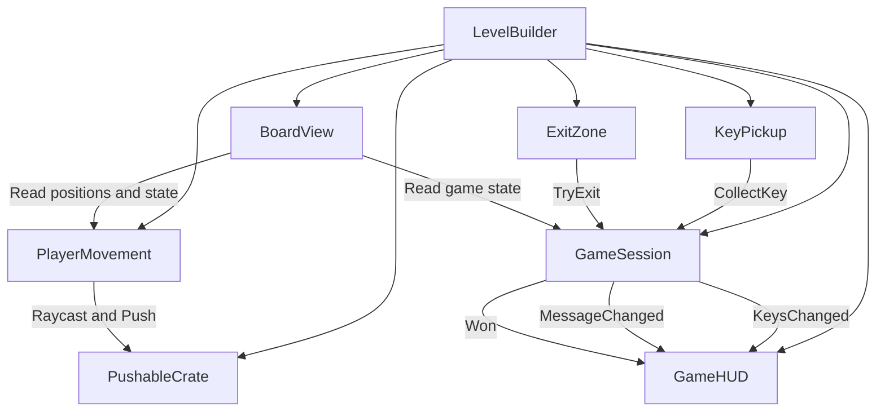

# Code Escape

## Assignment 4 — Core Gameplay, Physics and Architecture

### Game Overview

Code Escape is a top-down puzzle adventure developed in Unity 6 using C#.

The player explores a maze, collects three keys, interacts with a physics-based crate, and reaches the green exit to escape.

The project demonstrates Unity physics, event-based communication, and modular game architecture.

### How to Play

The player must collect all three keys scattered throughout the maze.

After collecting the keys, the player must reach the green exit to complete the level.

A movable crate provides an additional physics interaction.

**Controls**

- W / A / S / D — Move
- Arrow keys — Move
- Space — Push the crate in the facing direction
- R — Restart
- On-screen controls — Move, push and restart

**Win condition:** Collect all three keys and reach the exit.

When the player wins, the game displays **YOU ESCAPED!** and stops normal movement. The player can restart using the Play Again button.

### Running the Project

1. Clone or download the GitHub repository.
2. Open Unity Hub.
3. Add the project from disk.
4. Open using Unity 6.
5. Open `Assets/Scenes/Main.unity`.
6. Press Play.

### Project Structure

```text
Assets/
├── Scenes/
│   └── Main.unity
├── Scripts/
│   ├── Player/
│   │   └── PlayerMovement.cs
│   ├── Physics/
│   │   └── PushableCrate.cs
│   ├── Collectibles/
│   │   └── KeyPickup.cs
│   ├── Game/
│   │   ├── GameSession.cs
│   │   ├── LevelBuilder.cs
│   │   └── ExitZone.cs
│   └── UI/
│       ├── GameHUD.cs
│       └── BoardView.cs
Packages/
ProjectSettings/
```

### Architecture Diagram



### Class Responsibilities

| Class | Responsibility |
|---|---|
| LevelBuilder | Constructs the maze and gameplay objects |
| PlayerMovement | Handles player movement and pushing interactions |
| PushableCrate | Handles physical crate movement and collisions |
| KeyPickup | Detects key collection |
| ExitZone | Detects entry into the exit |
| GameSession | Tracks keys, victory and restart logic |
| GameHUD | Displays key count, messages, controls and victory UI |
| BoardView | Draws the maze and game objects |

Each class has a focused responsibility, following the Single Responsibility Principle.

### Physics Implementation

Code Escape implements all five required physics features.

**1. CharacterController**

`PlayerMovement` uses `CharacterController.Move` for player movement and collision handling.

**2. Rigidbody**

`PushableCrate` uses a Rigidbody for physical movement.

Keys and the exit also use kinematic Rigidbodies with trigger colliders.

**3. AddForce**

`PushableCrate.Push` uses `Rigidbody.AddForce` with `ForceMode.Impulse` when the player pushes the crate.

**4. Raycast**

`PlayerMovement` uses `Physics.Raycast` to detect a pushable crate in front of the player.

**5. Collision**

`PushableCrate` implements `OnCollisionEnter(Collision)` to detect and log collisions.

`KeyPickup` and `ExitZone` additionally use trigger interactions.

Joints and Effectors were not required.

### Event-Based Communication

The game uses C# events to communicate changes in the game state.

`GameSession` publishes three events:

- `KeysChanged` — Sent when a key is collected.
- `MessageChanged` — Sent when the gameplay message changes.
- `Won` — Sent when the player completes the game.

`GameHUD` listens to these events and updates the interface.

Event subscriptions are established in `OnEnable` when the session reference is available, with initialization also handled in `Start`. They are removed in `OnDisable`.

This avoids direct calls from `GameSession` to the UI.

### Architecture Decisions

**1. Event-based communication instead of direct UI calls**

Chosen: `GameSession` publishes C# events, and `GameHUD` listens.

Alternative: `GameSession` directly updates UI elements.

Reason: event-based communication reduces dependencies and allows the UI to change without modifying game rules.

**2. Separate physics from visual rendering**

Chosen: Unity physics components handle movement and interactions, while `BoardView` draws the maze using IMGUI.

Alternative: render the entire game using 3D meshes and materials.

Reason: the simpler rendering system reduces dependencies on runtime shaders and supports the project's browser-focused design.

**3. Small specialized components instead of one large manager**

Chosen: separate classes for player movement, crate physics, key collection, exit detection and game state.

Alternative: one script responsible for all game mechanics.

Reason: smaller components are easier to test, debug and extend.

### Configurable Gameplay Values

The following values are exposed through serialized fields:

- `PlayerMovement.speed`
- `PlayerMovement.pushDistance`
- `PlayerMovement.pushImpulse`
- `PushableCrate.maxSpeed`
- `GameSession.requiredKeys`

These settings allow gameplay tuning without modifying the main logic.

### Extending the Game

**Adding a new key**

1. Open `LevelBuilder.cs`.
2. Add another `K` tile to the maze layout.
3. Change `requiredKeys` in `GameSession` to match the new number of keys.

The existing `KeyPickup` component handles collection, and the HUD receives updated values through events.

**Adding a new obstacle**

1. Update the maze layout in `LevelBuilder.cs`.
2. Add any necessary collider or gameplay behavior.
3. Update `BoardView.cs` if the new obstacle requires a different visual representation.

The player movement and game state classes do not need to change for an ordinary wall.

**Changing the win condition**

Modify `GameSession.cs`, which contains the rules for completing the game.

`ExitZone` continues to report exit interactions, and `GameHUD` continues to respond to game events.

### Static Variables and Singleton Usage

The project does not use a custom gameplay singleton.

`GameSession` is instantiated for the level and passed to the relevant gameplay components.

This avoids unnecessary global game state and makes dependencies easier to understand.

Unity's built-in static APIs, including `Input`, `Physics`, `GUI`, and `SceneManager`, are used for engine functionality.


### Technologies

- Unity 6
- C#
- Unity 3D Physics
- CharacterController
- Rigidbody and AddForce
- Raycast and collision detection
- C# Events
- Unity IMGUI
- Web build

### Play Online

**itch.io:** https://yvvvvvv.itch.io/code-escape-2
